<div align="center">

<!-- Animated 60fps SVG Hero Banner -->
<a href="#how-it-works">
  
</a>

<br/><br/>

[](#requirements)
[](#memory-optimization)
[](#non-blocking-screen-area)
[](#downloads--quick-install)
[](#textizo-davinci-resolve-animation-presets)
[](#about-the-developer)

<br/>

**A fluid, native Dynamic Island designed specifically for Windows 11.**  
*A single shape at the top of your screen that rests unobtrusively, knows what your machine is doing, and opens with spring physics into the seven things you actually reach for.*

</div>

---

## 🎬 How It Works (Animated Walkthrough)

<div align="center">

<!-- Embedded Walkthrough Animation -->


<p align="center">
  <i>Watch Notchpyx in action: Resting Notch ➔ Proximity Hover ➔ Spring Expansion ➔ Media Player Equalizer ➔ ~20 MB System Monitor ➔ Volume HUD Morph ➔ Retract</i>
</p>

[▶ Download High-Quality 60fps MP4 Video](docs/animations/notchpyx_walkthrough.mp4)

</div>

---

## ⚡ Highlights & Key Innovations

### 🪟 Non-Blocking Screen Area (Dynamic Win32 Window Region)
Unlike previous notch overlays that steal mouse clicks across the entire display, **Notchpyx dynamically shapes its Win32 window region** in real-time (`SetWindowRgn`).
- When resting at the top, **99% of your screen is completely click-through**.
- When opened, **only the exact expanded card captures input**. You can freely click your browser tabs, taskbar, and background apps without interference.

### 🍃 Ultra-Low RAM Footprint (~20 MB Idle)
Optimized from ~285 MB down to **~20 MB live working set memory**:
- Integrated Win32 `SetProcessWorkingSetSize(-1, -1)` and `EmptyWorkingSet`.
- Low-memory image cache capping.
- Automatic memory garbage collection whenever the island retracts to resting state.

### 🎨 Pure Win32 & WinRT Native Architecture
- Zero third-party runtime package dependencies.
- Native Media playback hooks via `GlobalSystemMediaTransportControlsSessionManager`.
- Real-time hardware telemetry and privacy sensor detection.

---

## 🚀 Direct Download & 1-Click Install

### 💾 1-Click Windows Setup (.exe) &mdash; Use App Directly
- **Download Notchpyx:** [**`dist_installer/Notchpyx_Setup_v1.0.0.exe`**](https://github.com/aryanpyx/notchpyx/raw/main/dist_installer/Notchpyx_Setup_v1.0.0.exe)
- **Zero prerequisites**: No Flutter SDK, no Visual Studio C++, and no build tools required on your machine.
- **1-Click Launch**: Simply download and run `Notchpyx_Setup_v1.0.0.exe` to use Notchpyx directly.
- Automatically adds Start Menu and Desktop shortcuts, registers auto-start on boot, and includes a clean uninstaller.

---

## 📽️ Textizo DaVinci Resolve Animation Presets

Notchpyx includes procedural animated typography presets adhering to the official **Textizo AI Guide** (`clipizo.com` / `clipyx.com`). Content creators, video editors, and YouTubers can generate cinematic promotional reels for Notchpyx in DaVinci Resolve Fusion with zero manual keyframing!

```
assets/textizo_presets/
├── Textizo-01A.setting    # Clean "Notchpyx" Apple Reveal with subtle blur settle
└── Textizo-02A.setting    # High-energy "Dynamic Island" Sticker Pop with cyan neon glow
```

### How to Use Textizo Presets in DaVinci Resolve:
1. **Copy or Load Preset:**
   - Presets are automatically installed to:
     `%APPDATA%\Blackmagic Design\DaVinci Resolve\Support\Fusion\Settings\Textizo`
2. **In DaVinci Resolve Fusion:**
   - In the **Nodes** area, right-click any `Textizo` node -> **Settings > Load...** -> choose `Textizo-01A.setting` or `Textizo-02A.setting`.
   - Alternatively, drag and drop `Textizo-01A.setting` straight from File Explorer onto the Fusion canvas!
3. **Connect the Node:**
   - Connect the output to `MediaOut1` or into the foreground of a `Merge` node.
4. **Customize Text:**
   - Type your title or feature name in the Inspector under the **Text** tab. The spring timing adapts automatically!

---

## 📱 Module Showcase

<table>
  <tr>
    <td width="50%"></td>
    <td width="50%"></td>
  </tr>
  <tr>
    <td><b>Now & Clock</b> &mdash; Glanceable clock, ISO week, battery, weather, and schedule at a glance.</td>
    <td><b>Shortcuts</b> &mdash; Fast pinned launchers for YouTube, Spotify, Terminal, GitHub, and system utilities.</td>
  </tr>
  <tr>
    <td></td>
    <td></td>
  </tr>
  <tr>
    <td><b>Media Player</b> &mdash; Album art, track title, timeline progress, and media transport controls.</td>
    <td><b>System & Memory</b> &mdash; Real-time CPU, RAM graph (~20 MB engine), and network throughput.</td>
  </tr>
  <tr>
    <td></td>
    <td></td>
  </tr>
  <tr>
    <td><b>Shelf Scratchpad</b> &mdash; Instant drop zone for clipboard images, quick notes, and temporary items.</td>
    <td><b>Timers & Stopwatch</b> &mdash; Radial countdown dial and one-click duration presets computed against wall clock.</td>
  </tr>
</table>

---

## ⌨️ Shortcuts & Gestures

| Trigger | Action |
|---|---|
| `Ctrl` + `Alt` + `Space` | Open or toggle the Dynamic Island from anywhere |
| `←` / `→` | Navigate between pages (Now, Media, System, Shelf...) |
| **Scroll Wheel over Open Island** | Cycle through pages horizontally |
| **Scroll Wheel over Resting Pill** | Instant Volume HUD adjustment |
| **Hover pointer at top center** | Proximity reveal of resting notch |
| **Drag & Drop image onto Island** | Drop image directly into the Shelf slot |
| `Esc` or **Click Outside** | Seamlessly dismiss and trim memory |

---

## 🛠️ Project Structure

```
Notchpyx/
├── assets/
│   ├── app_icon.png           # Notchpyx high-res app icon
│   └── textizo_presets/       # DaVinci Resolve Fusion motion presets (.setting)
├── docs/
│   ├── animations/            # 60fps SVG banner & walkthrough GIF/MP4 videos
│   ├── screenshots/           # UI module screenshots
│   └── WINDOWS_INTEGRATION.md # Win32 / WinRT native architecture reference
├── lib/
│   ├── app/                   # Coordinator, bootstrap, and window lifecycles
│   ├── island/                # Spring physics state machine and geometry stage
│   ├── modules/               # Media, System, Shelf, Timers, Calendar, Clock
│   └── native/                # WindowsRegionHelper & native C++ channel bridges
├── windows/                   # C++ Win32/WinRT implementation
└── Notchpyx_Setup_v1.0.0.exe  # Standalone installer wizard
```

---

## 👨‍💻 About the Developer

**Aryan Pandey**  
- **Email:** [aryanpandey52355@gmail.com](mailto:aryanpandey52355@gmail.com)  
- **Project:** Notchpyx (Dynamic Island for Windows 11)

---

## 📄 Licence

Copyright © 2026 **Aryan Pandey**. All rights reserved.  
Built with Flutter & native Win32/WinRT C++.
